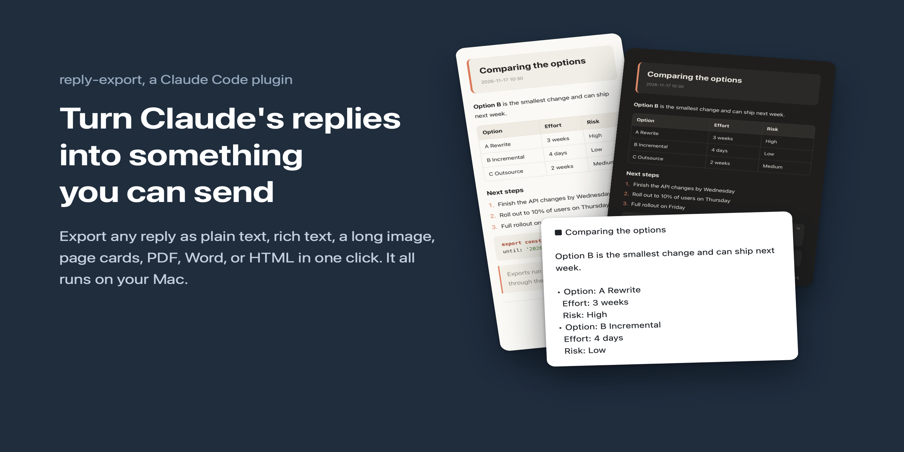
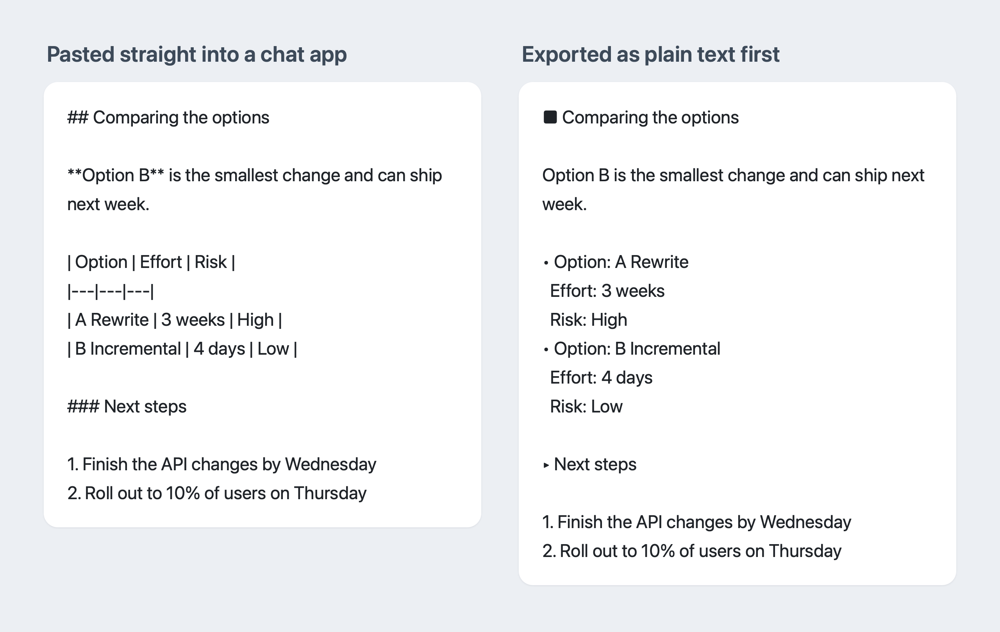
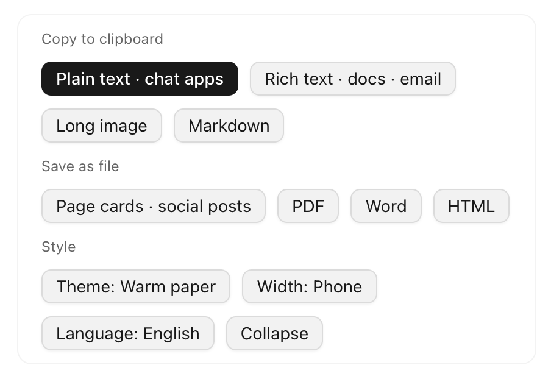
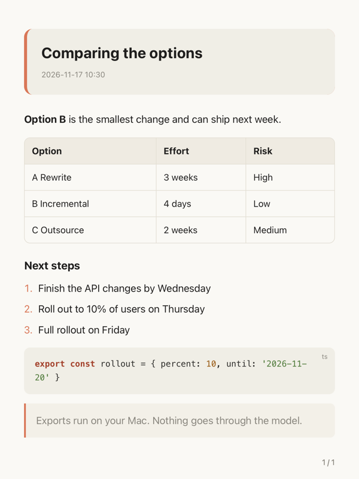

<p align="center">
  
</p>

<p align="center">
  <a href="README.md">中文</a> | English
</p>

<p align="center">
  <a href="https://github.com/junjunup/claude-reply-export/actions/workflows/test.yml"></a>
  <a href="LICENSE"></a>
  
</p>

Claude writes great answers, but paste one into a chat app and you get a wall of `##`, `**` and `|---|`.

**reply-export** is a Claude Code plugin that adds an "⤓ Export" button under every reply. One click and the reply is ready to send: plain text, rich text, a long image, page cards, PDF, Word, or HTML.

<p align="center">
  
</p>

## Get started

**1. Install** (in a terminal)

```bash
claude plugin install reply-export --marketplace junjunup/claude-reply-export
```

**2. Restart Claude Code.**

**3. Click "⤓ Export" under a reply and pick a format.**



That's it. Everything runs on your Mac. Nothing goes through the model, and it uses no tokens.

## Pick the format for where it's going

| Sending it to | Click | You get |
|---|---|---|
| Chat apps | **Plain text** | Markdown symbols removed, tables turned into "field: value" lines, readable as soon as you paste |
| Docs, email, Word | **Rich text** | Headings, bold, tables, and code highlighting survive the paste |
| A chat, as one picture | **Long image** | Copied to the clipboard so you can paste it straight in, and saved as a PNG |
| Social posts | **Page cards** | Several 3:4 cards with page numbers; long code blocks break between lines |
| An archive, a printer, a colleague | **PDF** | A4 pages with page numbers and clickable links; the file is also copied so you can paste it into a chat |
| Further editing | **Word** | `.docx`; the file is also copied |
| The web | **HTML** | One self-contained page |
| Anywhere that renders Markdown | **Markdown** | The original text |

Long images and cards come in three themes, switched under Style in the menu:

<table>
  <tr>
    <td></td>
    <td></td>
    <td></td>
  </tr>
  <tr><td align="center">Warm paper</td><td align="center">Clean white</td><td align="center">Dark</td></tr>
</table>

## Details

- **It exports the whole reply.** When a reply is split up by tool calls, the plugin joins the parts back together and skips progress notes like "Let me look at the code first." Thinking is never exported.
- **Where the button is:** always shown on the latest reply; on earlier replies, it appears when you hover. It doesn't show while a reply is still being written.
- **Title card:** a reply that opens with a heading gets a title card with the date in long images and cards.
- **Formatting:** code blocks are syntax-highlighted; in mixed Chinese and English text a space is added between the two (never inside code or URLs); footnotes become superscript numbers with the notes at the end.
- **Very tall images:** if a long image is taller than about 12,000 pixels, you get a hint to use Page cards instead, since chat apps compress very tall images.
- **Remembered choices:** theme, width (Phone / Desktop), and interface language (Auto / 中文 / English) are remembered.
- **Where files go:** `~/Downloads/Claude Exports/` (`~/Downloads/Claude导出/` with the Chinese interface).

## Privacy

**Before exporting, the plugin checks the reply for sensitive information.** If it finds any, you choose **Mask and export**, **Export as is**, or **Cancel**:

| Kind | Example | Masked |
|---|---|---|
| Local path | `/Users/yourname/project`, `C:\Users\yourname` | `~/project` |
| Email address | `jane.doe@company.com` | `j•••@company.com` |
| Phone number (mainland China mobile) | `13812345678`, `+86 138 1234 5678` | `138••••5678` |
| IP address | `192.168.1.20` | `192.168.•.•` |
| Possible secret | API keys (OpenAI, Anthropic, GitHub, AWS, Stripe and more), JWTs, `Bearer` tokens, private keys, `password=…`, passwords in URLs | Only the first few characters kept |

**Nothing is uploaded, and rendering is offline:**
- Exports never go through the model and are never uploaded.
- When rendering long images, cards, PDFs, rich text, and Word files, remote images in a reply become an "[Image: description]" placeholder and are never downloaded.
- Only the HTML export keeps image links.

## Installation and requirements

Besides the command above, you can:

- **Install in two steps:** `claude plugin marketplace add junjunup/claude-reply-export`, then `claude plugin install reply-export@claude-reply-export`.
- **Install in the Claude desktop app:** click **+** next to the input box → **Plugins** → **Add marketplace**, enter `junjunup/claude-reply-export`, then **Add plugin**.

| Feature | Needs |
|---|---|
| Plain text, Markdown | Any Mac |
| Rich text, long image, page cards, PDF | Xcode Command Line Tools (run `xcode-select --install` if you don't have them) |
| Word | macOS's built-in `textutil` for the conversion; putting the file on the clipboard also needs the Xcode Command Line Tools |

The first time you export rich text, a long image, cards, a PDF, or Word, the plugin builds a small renderer on your Mac. That takes about 10–30 seconds, once. Windows and Linux aren't supported yet.

## FAQ

<details>
<summary><b>I don't see the Export button.</b></summary>

1. Restart Claude Code after installing.
2. The button doesn't show while a reply is still being written. On earlier replies, hover to reveal it.
3. Run `claude plugin list` and check that `reply-export` is enabled.
</details>

<details>
<summary><b>The button shows up twice.</b></summary>

Both the installed plugin and a local development copy are loaded. Turn one of them off.
</details>

<details>
<summary><b>It says the Xcode Command Line Tools are required.</b></summary>

Run `xcode-select --install` in a terminal, then export again.
</details>

<details>
<summary><b>The first export is slow.</b></summary>

On first use, and after each plugin update, the renderer is built once (about 10–30 seconds).
</details>

<details>
<summary><b>My long image looks blurry in a chat app.</b></summary>

Chat apps compress very tall images. Use Page cards instead, or switch Width to Desktop under Style.
</details>

<details>
<summary><b>Why did the images in my reply turn into text?</b></summary>

To stay offline, remote images are replaced with placeholders when rendering. Use the HTML export if you need the images.
</details>

<details>
<summary><b>What happened to what was on my clipboard?</b></summary>

Copy exports, PDF, and Word replace the clipboard contents, so you can paste right away.
</details>

<details>
<summary><b>Are there known limitations?</b></summary>

- Math (`$$…$$`) is shown as written, not rendered.
- In very long sessions, the earliest replies may have no Export button: the plugin can only read the most recent 4,096 messages of a session.
</details>

## Updating and uninstalling

Update to the latest version, then restart Claude Code:

```bash
claude plugin marketplace update claude-reply-export
```
```bash
claude plugin update reply-export@claude-reply-export
```

Uninstall:

```bash
claude plugin uninstall reply-export@claude-reply-export
```

After uninstalling, you can also remove the cached renderer:

```bash
rm -rf ~/Library/Caches/reply-export
```

## Contributing

<details>
<summary><b>How it works and source layout</b></summary>

- **The button**: when Claude Code draws a reply, the plugin adds an export card at the end, then looks up which whole reply that text belongs to in the session transcript.
- **Conversion**: Markdown is parsed with [marked](https://github.com/markedjs/marked) and turned into plain text or HTML with inline styles.
- **Rendering**: long images, cards, and PDFs go to [`native/helper.swift`](native/helper.swift), which renders the page with the system's WebKit and splits it into pages. It's compiled on first use and cached in `~/Library/Caches/reply-export/`.
- **Clipboard and files**: the clipboard is written with the system's `pbcopy` and `NSPasteboard`; Word files are made with `textutil`.

```
hooks/register.tsx   button, menu, export flow
hooks/reply.ts       finding the whole reply in the transcript
hooks/convert.ts     Markdown → plain text / rich text / pages
hooks/privacy.ts     privacy check and masking
hooks/i18n.ts        Chinese and English interface text
native/helper.swift  WebKit rendering, pagination, clipboard
```
</details>

```bash
claude plugin test            # unit and UI tests
claude plugin validate .      # check the plugin structure
node scripts/native-test.ts   # build the native helper and really render a long image, cards and a PDF (leaves the clipboard alone)
node scripts/demo.ts          # regenerate the sample cards and long image
node scripts/hero.ts          # regenerate the banner and the before/after image (run demo.ts first)
```

GitHub Actions runs the first three on macOS for every push. See [CHANGELOG.md](CHANGELOG.md) for release notes. Don't load a development copy alongside the installed plugin, or the button will appear twice.

[Issues](https://github.com/junjunup/claude-reply-export/issues) and pull requests are welcome.

## License

[MIT](LICENSE). Markdown parsing uses [marked](https://github.com/markedjs/marked) (MIT, see [`hooks/vendor/marked.LICENSE.md`](hooks/vendor/marked.LICENSE.md)).
