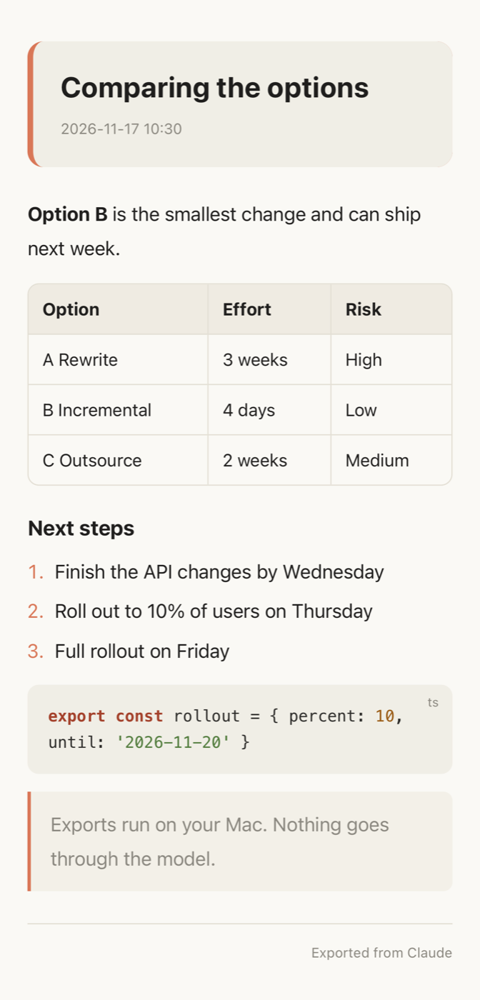
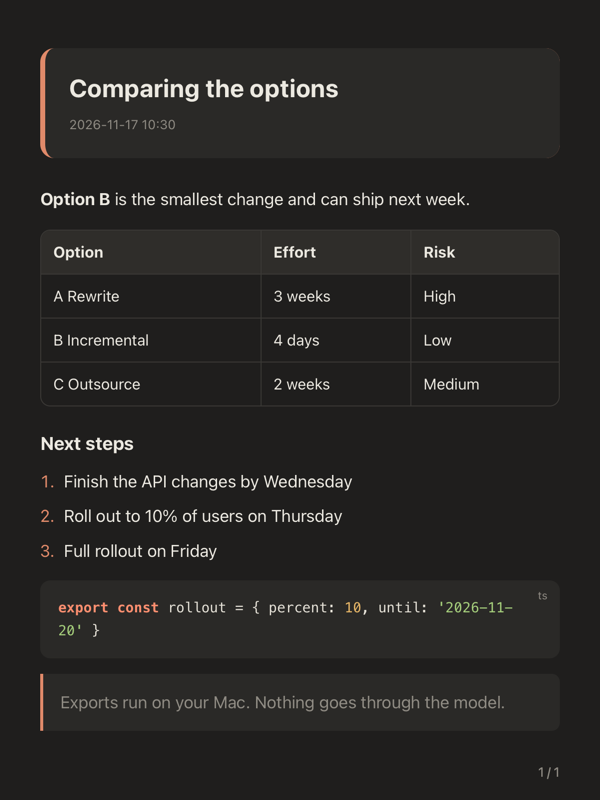
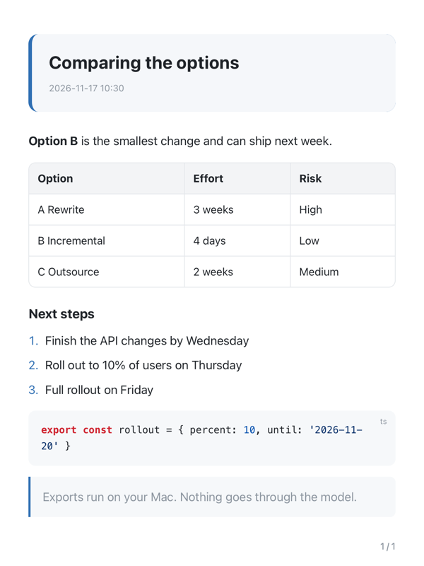

# reply-export: one-click export for Claude replies

[中文](README.md) | English

[](https://github.com/junjunup/claude-reply-export/actions/workflows/test.yml)
[](LICENSE)


A Claude Code plugin that adds an "⤓ Export" button under every reply. One click turns the reply into something you can paste into a chat app, a doc, an email, or a social post: plain text, rich text, a long image, page cards, PDF, Word, or HTML.

Everything runs on your Mac. Nothing goes through the model, and it uses no tokens.

<table>
  <tr>
    <td width="44%"></td>
    <td></td>
  </tr>
  <tr>
    <td align="center">Long image · Warm paper</td>
    <td align="center">Page card · Dark</td>
  </tr>
</table>

## Why

Claude writes Markdown, but most places you share to don't render it:

- Paste a reply into a chat app and you get raw `**`, `##` and `|---|`.
- Tables are unreadable on a phone.
- Posting to social media means taking and stitching screenshots by hand.

reply-export turns each of these into one click.

## Quick start

**1. Install** (in a terminal)

```bash
claude plugin install reply-export --marketplace junjunup/claude-reply-export
```

Or in two steps: `claude plugin marketplace add junjunup/claude-reply-export`, then `claude plugin install reply-export@claude-reply-export`.

In the Claude desktop app: click **+** next to the input box → **Plugins** → **Add marketplace**, enter `junjunup/claude-reply-export`, then **Add plugin**.

**2. Restart Claude Code.**

**3. Ask Claude anything, then click "⤓ Export" under the reply.**

The first time you export rich text, a long image, cards, a PDF, or Word, the plugin builds a small renderer on your Mac. That takes about 10–30 seconds, once. After that, exports are near-instant.

## Using it

**Where the button is**
- On the latest reply, the button is always shown at the end.
- On earlier replies, it appears when you hover over the reply.
- It appears once the reply has finished, not while it's still being written.

**It exports the whole reply.** When a reply is split up by tool calls (reading files, running commands), the plugin joins the parts back together and skips progress notes like "Let me look at the code first." Thinking is never exported.

Click "⤓ Export" and this card opens under the reply:


What each option does:

| Group | Format | Good for | What you get |
|---|---|---|---|
| **Copy to clipboard** | Plain text | Chat apps | Markdown symbols removed, tables turned into "field: value" lines |
| | Rich text | Docs, email, Word | HTML, RTF and plain text on the clipboard, so formatting survives the paste |
| | Long image | Sending in a chat | Copied to the clipboard and saved as a PNG |
| | Markdown | Places that render Markdown | The original text |
| **Save as file** | Page cards | Social posts | Several 3:4 cards with page numbers; long code blocks break between lines |
| | PDF | Archiving, printing | A4 pages with page numbers and clickable links; the file is also copied so you can paste it into a chat |
| | Word | Further editing | `.docx`; the file is also copied |
| | HTML | Sharing as a web page | One self-contained page |
| **Style** | Theme | | Warm paper / Clean white / Dark |
| | Width | | Phone / Desktop (for long images) |
| | Language | | Auto / 中文 / English |

Your style choices are remembered. Files go to `~/Downloads/Claude Exports/` (`~/Downloads/Claude导出/` with the Chinese interface), and Finder selects each saved file.

### What plain text looks like

Pasted into a chat app, it looks like this:

```
■ Comparing the options

Option B is the smallest change. See the design doc (https://example.com/design).

• Option: A Rewrite
  Effort: 3 weeks
  Risk: High
• Option: B Incremental
  Effort: 4 days
  Risk: Low

▸ Next steps

1. Finish the API changes by Wednesday
2. Roll out to 10% of users on Thursday
```

<details>
<summary>Claude's original reply (Markdown)</summary>

```markdown
## Comparing the options

**Option B** is the smallest change. See the [design doc](https://example.com/design).

| Option | Effort | Risk |
|---|---|---|
| A Rewrite | 3 weeks | High |
| B Incremental | 4 days | Low |

### Next steps

1. Finish the API changes by Wednesday
2. Roll out to 10% of users on Thursday
```

</details>

### Three themes

<table>
  <tr>
    <td></td>
    <td></td>
    <td></td>
  </tr>
  <tr><td align="center">Warm paper</td><td align="center">Clean white</td><td align="center">Dark</td></tr>
</table>

### Details

- A reply that opens with a heading gets a title card with the date.
- Code blocks are syntax-highlighted, with the language shown in the corner.
- In mixed Chinese and English text, a space is added between the two (never inside code or URLs).
- Footnotes become superscript numbers, with the notes collected at the end.
- If a long image is very tall (over about 12,000 pixels), you get a hint that chat apps may compress it and Page cards may work better.

## Privacy and security

**Every export is checked first.** If the reply contains any of the following, you're asked to choose **Mask and export**, **Export as is**, or **Cancel**:

| Kind | Example | Masked |
|---|---|---|
| Local path | `/Users/yourname/project`, `C:\Users\yourname` | `~/project` |
| Email address | `jane.doe@company.com` | `j•••@company.com` |
| Phone number (mainland China mobile) | `13812345678`, `+86 138 1234 5678` | `138••••5678` |
| IP address | `192.168.1.20` | `192.168.•.•` |
| Possible secret | API keys (OpenAI, Anthropic, GitHub, AWS, Stripe and more), JWTs, `Bearer` tokens, private keys, `password=…`, passwords in URLs | Only the first few characters kept |

**Everything stays on your Mac:**
- Exports never go through the model and are never uploaded.
- Rendering long images, cards, PDFs, rich text, and Word files is offline: remote images in a reply become an "[Image: description]" placeholder and are never downloaded.
- Only the HTML export keeps image links, which load when you open the page in a browser.

## Requirements

| Feature | Needs |
|---|---|
| Plain text, Markdown | Any Mac |
| Rich text, long image, page cards, PDF | Xcode Command Line Tools (run `xcode-select --install` if you don't have them) |
| Word | macOS's built-in `textutil` for the conversion; putting the file on the clipboard also needs the Xcode Command Line Tools |

Windows and Linux aren't supported yet.

## FAQ

**I don't see the Export button.**
1. Restart Claude Code after installing.
2. The button doesn't show while a reply is still being written. On earlier replies, hover to reveal it.
3. Run `claude plugin list` and check that `reply-export` is enabled.

**The button shows up twice.**
Both the installed plugin and a local development copy are loaded. Turn one of them off.

**It says the Xcode Command Line Tools are required.**
Run `xcode-select --install` in a terminal, then export again.

**The first export is slow.**
On first use, and after each plugin update, the renderer is built once (about 10–30 seconds).

**My long image looks blurry in a chat app.**
Chat apps compress very tall images. Use Page cards instead, or switch Width to Desktop under Style.

**Why did the images in my reply turn into text?**
To stay offline, remote images are replaced with placeholders when rendering. Use the HTML export if you need the images.

**What happened to what was on my clipboard?**
Copy exports, PDF, and Word replace the clipboard contents, so you can paste right away.

**Known limitations**
- Math (`$$…$$`) is shown as written, not rendered.
- In very long sessions, the earliest replies may have no Export button: the plugin can only read the most recent 4,096 messages of a session.

## Updating and uninstalling

Update to the latest version:

```bash
claude plugin marketplace update claude-reply-export
```
```bash
claude plugin update reply-export@claude-reply-export
```

Then restart Claude Code.

Uninstall:

```bash
claude plugin uninstall reply-export@claude-reply-export
```

After uninstalling, you can also remove the cached renderer:

```bash
rm -rf ~/Library/Caches/reply-export
```

## How it works

- **The button**: when Claude Code draws a reply, the plugin adds an export card at the end, then looks up which whole reply that text belongs to in the session transcript.
- **Conversion**: Markdown is parsed with [marked](https://github.com/markedjs/marked) and turned into plain text or HTML with inline styles.
- **Rendering**: long images, cards, and PDFs go to [`native/helper.swift`](native/helper.swift), which renders the page with the system's WebKit and splits it into pages. It's compiled on first use and cached in `~/Library/Caches/reply-export/`.
- **Clipboard and files**: the clipboard is written with the system's `pbcopy` and `NSPasteboard`; Word files are made with `textutil`.

Source layout:

```
hooks/register.tsx   button, menu, export flow
hooks/reply.ts       finding the whole reply in the transcript
hooks/convert.ts     Markdown → plain text / rich text / pages
hooks/privacy.ts     privacy check and masking
hooks/i18n.ts        Chinese and English interface text
native/helper.swift  WebKit rendering, pagination, clipboard
```

## Development

```bash
claude plugin test            # unit and UI tests
claude plugin validate .      # check the plugin structure
node scripts/native-test.ts   # build the native helper and really render a long image, cards and a PDF (leaves the clipboard alone)
node scripts/demo.ts          # regenerate the images in this README
```

GitHub Actions runs all three on macOS for every push. See [CHANGELOG.md](CHANGELOG.md) for release notes.

Don't load a development copy alongside the installed plugin, or the button will appear twice.

## License

[MIT](LICENSE). Markdown parsing uses [marked](https://github.com/markedjs/marked) (MIT, see [`hooks/vendor/marked.LICENSE.md`](hooks/vendor/marked.LICENSE.md)).
