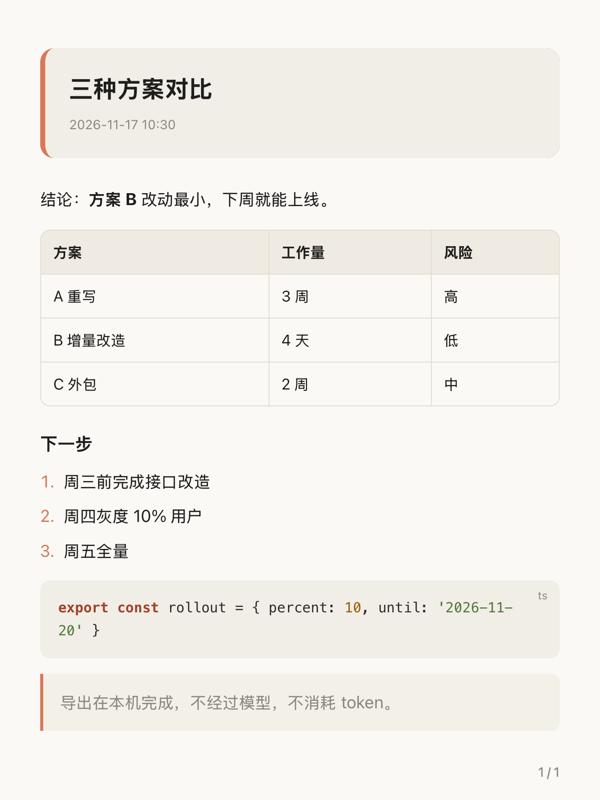

# Claude 回复一键导出 · reply-export

中文 | [English](README.en.md)

[](https://github.com/junjunup/claude-reply-export/actions/workflows/test.yml)
[](LICENSE)


一个 Claude Code 插件：在每条回复下面加一个「⤓ 导出」按钮，把回复一键转成微信、飞书、小红书、邮件能直接用的格式，包括纯文本、富文本、长图、分页卡片、PDF、Word 和 HTML。

全部在本机完成，不经过模型，不消耗 token。

<table>
  <tr>
    <td width="44%"></td>
    <td></td>
  </tr>
  <tr>
    <td align="center">长图 · 暖纸主题</td>
    <td align="center">分页卡片 · 深色主题</td>
  </tr>
</table>

## 为什么需要它

Claude 的回复是 Markdown，但大多数地方不认 Markdown：

- 直接粘贴到微信，满屏都是 `**`、`##` 和 `|---|`。
- 表格在手机上根本没法看。
- 想发朋友圈或小红书，还得自己截图、拼图。

reply-export 把这些事变成一次点击。

## 快速开始

**1. 安装**（在终端运行）

```bash
claude plugin install reply-export --marketplace junjunup/claude-reply-export
```

也可以分两步：先 `claude plugin marketplace add junjunup/claude-reply-export`，再 `claude plugin install reply-export@claude-reply-export`。

在 Claude 桌面 app 里：点输入框旁的 **+** → **Plugins** → **Add marketplace**，填入 `junjunup/claude-reply-export`，再 **Add plugin**。

**2. 重启 Claude Code。**

**3. 让 Claude 回答点什么，点回复下面的「⤓ 导出」。**

第一次导出富文本、长图、卡片、PDF 或 Word 时，插件会在本机编译一个渲染小助手，大约需要 10–30 秒。之后就是秒出。

## 怎么用

**按钮在哪**
- 最新一条回复：按钮一直显示在回复末尾。
- 更早的回复：鼠标移到回复上时出现。
- 回复还在输出时不显示，写完后出现。

**导出的是整条回复。** 一条回复中间如果穿插了工具调用（读文件、跑命令），插件会把各段正文拼起来，并跳过「我先看一下代码」这类过程播报。思考过程不会被导出。

点开「⤓ 导出」后，回复下面会展开这张卡片：


各项的作用：

| 分组 | 格式 | 适合 | 效果 |
|---|---|---|---|
| **复制到剪贴板** | 纯文本 | 微信 | 去掉 Markdown 符号，表格改成「项：值」，标题加【】 |
| | 富文本 | 飞书、邮件、Word | 剪贴板里同时有 HTML、RTF 和纯文本，粘贴后保留格式 |
| | 长图 | 聊天里直接发 | 复制到剪贴板，同时保存 PNG |
| | Markdown | 发给认 Markdown 的地方 | 原文 |
| **保存为文件** | 分页卡片 | 小红书、朋友圈 | 3:4 多张卡片，带页码；长代码块按行分页 |
| | PDF | 存档、打印 | A4 分页，带页码，链接可点；文件同时复制，可在微信里直接粘贴发送 |
| | Word | 继续编辑 | `.docx`；文件同时复制 |
| | HTML | 网页分享 | 单个独立网页文件 |
| **样式** | 主题 | | 暖纸 / 简白 / 深色 |
| | 宽度 | | 手机 / 电脑（影响长图） |
| | 语言 | | 跟随系统 / 中文 / English |

样式的选择会被记住。文件保存在 `~/Downloads/Claude导出/`（英文界面下是 `~/Downloads/Claude Exports/`）。保存为文件的几种格式，导出后会在访达里选中生成的文件。

### 纯文本长什么样

粘到微信里是这样：

```
【三种方案对比】

结论：方案 B 改动最小，详见设计文档（https://example.com/design）。

• 方案：A 重写
　工作量：3 周
　风险：高
• 方案：B 增量改造
　工作量：4 天
　风险：低

▍下一步

1. 周三前完成接口改造
2. 周四灰度 10% 用户
```

<details>
<summary>Claude 的原文（Markdown）</summary>

```markdown
## 三种方案对比

结论：**方案 B** 改动最小，详见[设计文档](https://example.com/design)。

| 方案 | 工作量 | 风险 |
|---|---|---|
| A 重写 | 3 周 | 高 |
| B 增量改造 | 4 天 | 低 |

### 下一步

1. 周三前完成接口改造
2. 周四灰度 10% 用户
```

</details>

### 三套主题

<table>
  <tr>
    <td></td>
    <td></td>
    <td></td>
  </tr>
  <tr><td align="center">暖纸</td><td align="center">简白</td><td align="center">深色</td></tr>
</table>

### 细节

- 回复以标题开头时，标题会做成带日期的标题卡。
- 代码块有语法高亮，右上角标出语言。
- 中文和英文、数字之间自动加空格，代码和网址里不加。
- 脚注会改成上标数字，内容收到文末「注释」里。
- 图片很长（超过约 12000 像素）时会提示：发到微信可能被压缩，建议改用分页卡片。

## 隐私与安全

**导出前会做一次隐私检查。** 回复里如果有下面这些内容，会先问你「打码后导出 / 原样导出 / 取消」：

| 类型 | 例子 | 打码后 |
|---|---|---|
| 本机路径 | `/Users/你的名字/项目`、`C:\Users\你的名字` | `~/项目` |
| 邮箱 | `zhang.san@company.com` | `z•••@company.com` |
| 手机号 | `13812345678`、`+86 138 1234 5678` | `138••••5678` |
| IP 地址 | `192.168.1.20` | `192.168.•.•` |
| 疑似密钥 | API key（OpenAI、Anthropic、GitHub、AWS、Stripe 等）、JWT、`Bearer` 令牌、私钥、`password=…`、网址里的密码 | 只保留开头几位 |

**完全在本机运行：**
- 导出不经过模型，也不上传到任何地方。
- 渲染长图、卡片、PDF、富文本和 Word 时不联网：回复里的远程图片会换成「[图片：说明]」占位文字，不会被下载。
- 只有 HTML 导出保留图片链接，在浏览器里打开时才会加载。

## 环境要求

| 功能 | 需要 |
|---|---|
| 纯文本、Markdown | 任何 Mac |
| 富文本、长图、分页卡片、PDF | Xcode 命令行工具（没有的话运行 `xcode-select --install`） |
| Word | macOS 自带的 `textutil` 转换格式；把文件放进剪贴板时也要用到 Xcode 命令行工具 |

暂不支持 Windows 和 Linux。

## 常见问题

**看不到导出按钮？**
1. 装完插件后要重启 Claude Code。
2. 回复还在输出时不显示；更早的回复要把鼠标移上去才出现。
3. 运行 `claude plugin list`，确认 `reply-export` 是 enabled。

**按钮出现了两次？**
同时加载了已安装版本和本地开发版本，关掉其中一个就好。

**提示「需要 Xcode 命令行工具」？**
在终端运行 `xcode-select --install`，装完再导出一次。

**第一次导出很慢？**
首次使用（以及每次更新插件后）要编译渲染小助手，大约 10–30 秒，只需一次。

**长图发到微信变糊了？**
微信会压缩很长的图片。改用「分页卡片」，或者在「样式」里把宽度切到「电脑」。

**回复里的图片怎么变成了文字？**
为了不联网，渲染时远程图片都换成了占位文字。需要图片的话用 HTML 导出。

**导出后剪贴板里原来的内容没了？**
复制类导出、PDF 和 Word 都会覆盖剪贴板，这是为了能直接粘贴。

**已知限制**
- 数学公式（`$$…$$`）原样输出，不渲染。
- 特别长的会话里，很早的回复可能没有导出按钮：插件只能读到会话最近的 4096 条消息。

## 更新与卸载

更新到最新版：

```bash
claude plugin marketplace update claude-reply-export
```
```bash
claude plugin update reply-export@claude-reply-export
```

然后重启 Claude Code。

卸载：

```bash
claude plugin uninstall reply-export@claude-reply-export
```

卸载后还可以删掉渲染小助手的缓存：

```bash
rm -rf ~/Library/Caches/reply-export
```

## 工作原理

- **按钮**：插件在 Claude Code 绘制每条回复时，在回复末尾加上导出卡片，然后从会话记录里找到这段文字属于哪一整条回复。
- **转换**：Markdown 用 [marked](https://github.com/markedjs/marked) 解析，再转成纯文本或带内联样式的 HTML。
- **渲染**：长图、卡片和 PDF 交给 [`native/helper.swift`](native/helper.swift)，它用系统自带的 WebKit 渲染页面并分页。这个助手首次使用时编译，缓存在 `~/Library/Caches/reply-export/`。
- **剪贴板和文件**：写剪贴板用系统的 `pbcopy` 和 `NSPasteboard`，转 Word 用 `textutil`。

代码结构：

```
hooks/register.tsx   按钮、菜单、导出流程
hooks/reply.ts       从会话记录里定位整条回复
hooks/convert.ts     Markdown → 纯文本 / 富文本 / 页面
hooks/privacy.ts     隐私检查和打码
hooks/i18n.ts        中英文界面文字
native/helper.swift  WebKit 渲染、分页、剪贴板
```

## 开发

```bash
claude plugin test            # 单元测试和界面测试
claude plugin validate .      # 检查插件结构
node scripts/native-test.ts   # 编译原生助手，实际渲染长图、卡片、PDF 并检查（不碰剪贴板）
node scripts/demo.ts          # 重新生成 README 里的效果图
```

GitHub Actions 会在每次推送时在 macOS 上跑这三项。更新记录见 [CHANGELOG.md](CHANGELOG.md)。

开发时不要和已安装的版本同时加载，否则按钮会出现两次。

## 许可证

[MIT](LICENSE)。Markdown 解析使用 [marked](https://github.com/markedjs/marked)（MIT 许可，见 [`hooks/vendor/marked.LICENSE.md`](hooks/vendor/marked.LICENSE.md)）。
