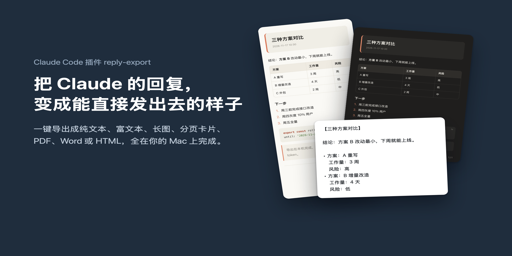
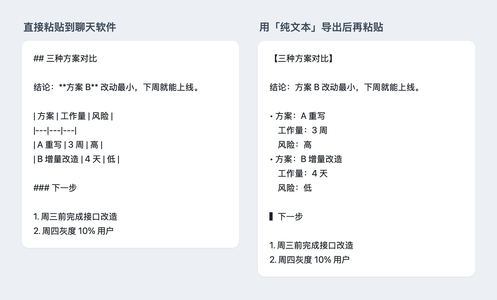
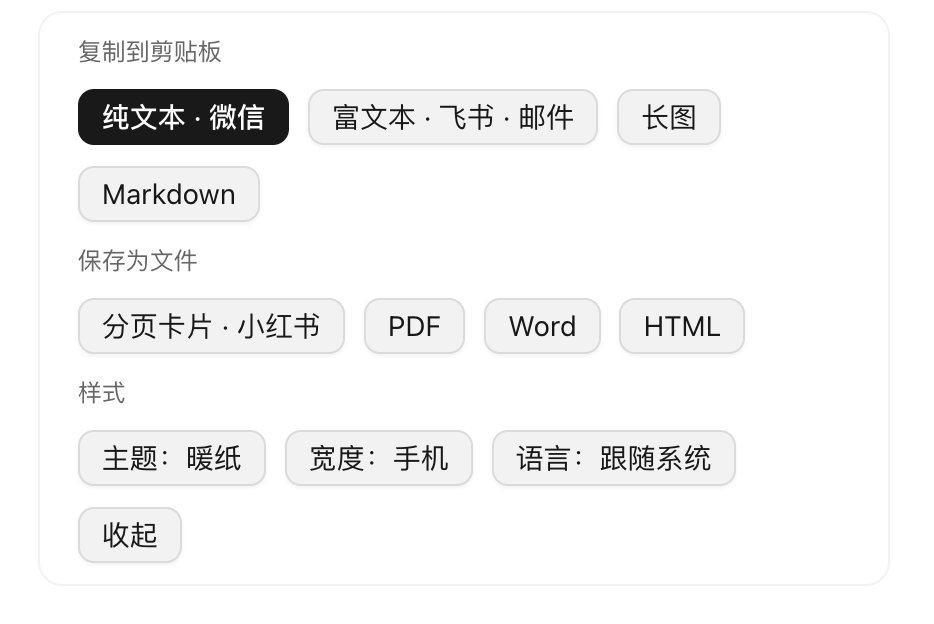
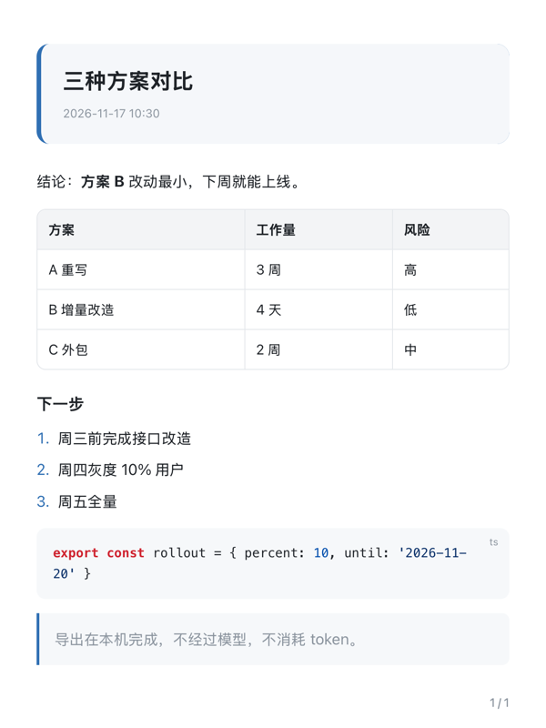

<p align="center">
  
</p>

<p align="center">
  中文 | <a href="README.en.md">English</a>
</p>

<p align="center">
  <a href="https://github.com/junjunup/claude-reply-export/actions/workflows/test.yml"></a>
  <a href="LICENSE"></a>
  
</p>

Claude 的回答写得再好，粘到微信里也是满屏的 `##`、`**` 和 `|---|`。

**reply-export** 是一个 Claude Code 插件。它在每条回复下面加一个「⤓ 导出」按钮，点一下，回复就变成能直接发出去的样子：纯文本、富文本、长图、分页卡片、PDF、Word 或 HTML。

<p align="center">
  
</p>

## 三步用上

**1. 安装**（在终端运行）

```bash
claude plugin install reply-export --marketplace junjunup/claude-reply-export
```

**2. 重启 Claude Code。**

**3. 点回复下面的「⤓ 导出」，选一种格式。**



就这样。所有处理都在你的 Mac 上完成，不经过模型，也不消耗 token。

## 要发到哪里，就点哪个

| 要发到 | 点 | 得到 |
|---|---|---|
| 微信、QQ、钉钉等聊天 | **纯文本** | 去掉 Markdown 符号，表格改成「项：值」，粘贴就能看 |
| 飞书文档、邮件、Word | **富文本** | 粘贴后保留标题、加粗、表格、代码高亮 |
| 聊天里发一张图 | **长图** | 复制到剪贴板，直接粘贴发送，同时存一份 PNG |
| 小红书、朋友圈 | **分页卡片** | 3:4 多张卡片，带页码，长代码块按行分页 |
| 存档、打印、发给同事 | **PDF** | A4 分页，带页码，链接可点；文件也复制好了，在微信里直接粘贴就能发送 |
| 继续编辑 | **Word** | `.docx`，文件同样已复制 |
| 发个网页 | **HTML** | 单个独立网页文件 |
| 认 Markdown 的地方 | **Markdown** | 原文 |

长图和卡片有三套主题，在菜单的「样式」里切换：

<table>
  <tr>
    <td></td>
    <td></td>
    <td></td>
  </tr>
  <tr><td align="center">暖纸</td><td align="center">简白</td><td align="center">深色</td></tr>
</table>

## 用起来的细节

- **导出的是整条回复。** 一条回复中间如果穿插了工具调用，插件会把各段正文拼起来，并跳过「我先看一下代码」这类过程播报。思考过程不会被导出。
- **按钮在哪：** 最新一条回复的按钮一直显示；更早的回复，鼠标移上去才出现；回复还在输出时不显示。
- **标题卡：** 回复以标题开头时，长图和卡片会把它做成带日期的标题卡。
- **排版：** 代码块有语法高亮；中文和英文、数字之间自动加空格（代码和网址里不加）；脚注改成上标数字，内容收到文末。
- **太长的图：** 长图超过约 12000 像素时会提示你改用分页卡片，因为聊天软件会压缩太长的图片。
- **记住选择：** 主题、宽度（手机 / 电脑）和界面语言（跟随系统 / 中文 / English）都会被记住。
- **文件位置：** 文件保存在 `~/Downloads/Claude导出/`，英文界面下是 `~/Downloads/Claude Exports/`。

## 隐私

**导出前，插件会先检查回复里有没有敏感信息。** 发现了就问你「打码后导出 / 原样导出 / 取消」：

| 类型 | 例子 | 打码后 |
|---|---|---|
| 本机路径 | `/Users/你的名字/项目`、`C:\Users\你的名字` | `~/项目` |
| 邮箱 | `zhang.san@company.com` | `z•••@company.com` |
| 手机号 | `13812345678`、`+86 138 1234 5678` | `138••••5678` |
| IP 地址 | `192.168.1.20` | `192.168.•.•` |
| 疑似密钥 | API key（OpenAI、Anthropic、GitHub、AWS、Stripe 等）、JWT、`Bearer` 令牌、私钥、`password=…`、网址里的密码 | 只保留开头几位 |

**导出不上传，也不联网：**
- 导出不经过模型，也不上传到任何地方。
- 渲染长图、卡片、PDF、富文本和 Word 时，回复里的远程图片会换成「[图片：说明]」占位文字，不会被下载。
- 只有 HTML 导出保留图片链接。

## 安装与环境

除了上面的命令，也可以：

- **分两步安装：** 先 `claude plugin marketplace add junjunup/claude-reply-export`，再 `claude plugin install reply-export@claude-reply-export`。
- **在 Claude 桌面 app 里安装：** 点输入框旁的 **+** → **Plugins** → **Add marketplace**，填入 `junjunup/claude-reply-export`，再 **Add plugin**。

| 功能 | 需要 |
|---|---|
| 纯文本、Markdown | 任何 Mac |
| 富文本、长图、分页卡片、PDF | Xcode 命令行工具（没有的话运行 `xcode-select --install`） |
| Word | macOS 自带的 `textutil` 转换格式；把文件放进剪贴板时也要用到 Xcode 命令行工具 |

第一次导出富文本、长图、卡片、PDF 或 Word 时，插件会在本机编译一个渲染小助手，大约需要 10–30 秒，之后就是秒出。暂不支持 Windows 和 Linux。

## 常见问题

<details>
<summary><b>看不到导出按钮？</b></summary>

1. 装完插件后要重启 Claude Code。
2. 回复还在输出时不显示；更早的回复要把鼠标移上去才出现。
3. 运行 `claude plugin list`，确认 `reply-export` 是 enabled。
</details>

<details>
<summary><b>按钮出现了两次？</b></summary>

同时加载了已安装版本和本地开发版本，关掉其中一个就好。
</details>

<details>
<summary><b>提示「需要 Xcode 命令行工具」？</b></summary>

在终端运行 `xcode-select --install`，装完再导出一次。
</details>

<details>
<summary><b>第一次导出很慢？</b></summary>

首次使用（以及每次更新插件后）要编译渲染小助手，大约 10–30 秒，只需一次。
</details>

<details>
<summary><b>长图发到微信变糊了？</b></summary>

微信会压缩很长的图片。改用「分页卡片」，或者在「样式」里把宽度切到「电脑」。
</details>

<details>
<summary><b>回复里的图片怎么变成了文字？</b></summary>

为了不联网，渲染时远程图片都换成了占位文字。需要图片的话用 HTML 导出。
</details>

<details>
<summary><b>导出后剪贴板里原来的内容没了？</b></summary>

复制类导出、PDF 和 Word 都会覆盖剪贴板，这是为了能直接粘贴。
</details>

<details>
<summary><b>有哪些已知限制？</b></summary>

- 数学公式（`$$…$$`）原样输出，不渲染。
- 特别长的会话里，很早的回复可能没有导出按钮：插件只能读到会话最近的 4096 条消息。
</details>

## 更新与卸载

更新到最新版，然后重启 Claude Code：

```bash
claude plugin marketplace update claude-reply-export
```
```bash
claude plugin update reply-export@claude-reply-export
```

卸载：

```bash
claude plugin uninstall reply-export@claude-reply-export
```

卸载后还可以删掉渲染小助手的缓存：

```bash
rm -rf ~/Library/Caches/reply-export
```

## 参与开发

<details>
<summary><b>工作原理和代码结构</b></summary>

- **按钮**：插件在 Claude Code 绘制每条回复时，在回复末尾加上导出卡片，然后从会话记录里找到这段文字属于哪一整条回复。
- **转换**：Markdown 用 [marked](https://github.com/markedjs/marked) 解析，再转成纯文本或带内联样式的 HTML。
- **渲染**：长图、卡片和 PDF 交给 [`native/helper.swift`](native/helper.swift)，它用系统自带的 WebKit 渲染页面并分页。这个助手首次使用时编译，缓存在 `~/Library/Caches/reply-export/`。
- **剪贴板和文件**：写剪贴板用系统的 `pbcopy` 和 `NSPasteboard`，转 Word 用 `textutil`。

```
hooks/register.tsx   按钮、菜单、导出流程
hooks/reply.ts       从会话记录里定位整条回复
hooks/convert.ts     Markdown → 纯文本 / 富文本 / 页面
hooks/privacy.ts     隐私检查和打码
hooks/i18n.ts        中英文界面文字
native/helper.swift  WebKit 渲染、分页、剪贴板
```
</details>

```bash
claude plugin test            # 单元测试和界面测试
claude plugin validate .      # 检查插件结构
node scripts/native-test.ts   # 编译原生助手，实际渲染长图、卡片、PDF 并检查（不碰剪贴板）
node scripts/demo.ts          # 重新生成 README 里的示例卡片和长图
node scripts/hero.ts          # 重新生成头图和对比图（要先运行 demo.ts）
```

GitHub Actions 会在每次推送时在 macOS 上跑前三项。更新记录见 [CHANGELOG.md](CHANGELOG.md)。开发时不要和已安装的版本同时加载，否则按钮会出现两次。

欢迎提 [Issue](https://github.com/junjunup/claude-reply-export/issues) 和 Pull Request。

## 许可证

[MIT](LICENSE)。Markdown 解析使用 [marked](https://github.com/markedjs/marked)（MIT 许可，见 [`hooks/vendor/marked.LICENSE.md`](hooks/vendor/marked.LICENSE.md)）。
