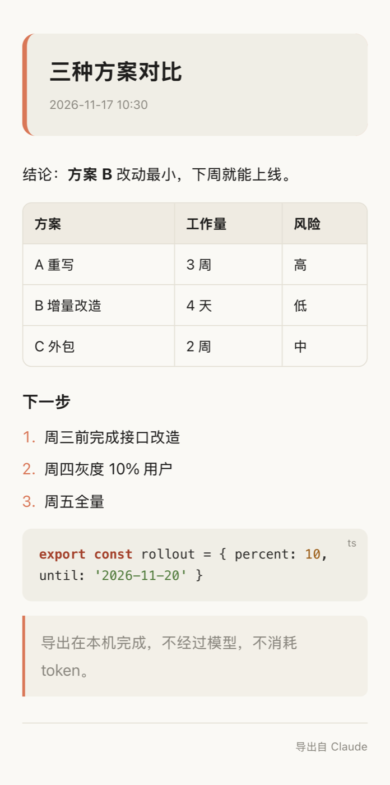
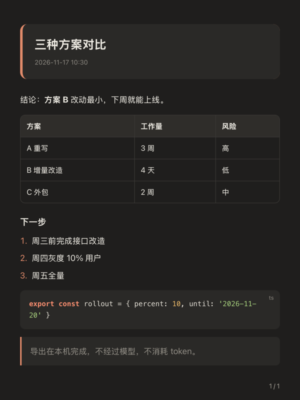

# Claude 回复一键导出（reply-export）

中文 | [English](README.en.md)

在 Claude Code 每条回复下方加一个「⤓ 导出」按钮，一键把回复转成适合各平台转发的格式。按钮在本机运行，不经过模型，不消耗 token。

<p>
  
  
</p>

## 能导出什么

| 分组 | 格式 | 适合 |
|---|---|---|
| 复制到剪贴板 | 纯文本 | 微信等不认 Markdown 的平台：去掉符号，表格转成「项：值」 |
| | 富文本 | 飞书、邮件、Word：剪贴板同时写入 HTML、RTF、纯文本 |
| | 长图 | 直接粘贴到聊天里；同时保存为 PNG |
| | Markdown | 原文 |
| 保存为文件 | 分页卡片 | 小红书、朋友圈：3:4 多张卡片，带页码 |
| | PDF | A4 分页，带页码，链接可点；长代码块按行分页；文件同时放进剪贴板 |
| | Word | .docx；文件同时放进剪贴板 |
| | HTML | 独立网页 |

- 三套主题（暖纸 / 简白 / 深色）、两种宽度（手机 / 电脑），界面支持中文和英文（默认跟随系统语言，可在「样式」里切换），选择会被记住。
- 回复以标题开头时自动做成标题卡；代码块语法高亮；中英文之间自动加空格。
- 「整条回复」会把被工具调用隔开的正文拼起来，并跳过中途的进度播报。
- **导出前隐私检查**：发现本机路径、邮箱、手机号、IP 地址、疑似密钥（API key、令牌、私钥、网址里的密码等）时会提示，可选择打码后导出。

文件保存在 `~/Downloads/Claude导出/`（英文界面下为 `~/Downloads/Claude Exports/`）。

## 安装

在终端的 Claude Code 会话里：

```
/plugin install reply-export --marketplace junjunup/claude-reply-export
```

接着按 `y` 添加 marketplace，再选择安装范围（回车选用户范围）。

在 shell 里：

```bash
claude plugin install reply-export --marketplace junjunup/claude-reply-export
```

在 Claude 桌面 app 里（`/plugin` 不可用时）：点输入框旁的 **+** → **Plugins** → **Add marketplace**，填入 `junjunup/claude-reply-export`，再 **Add plugin**。

## 环境要求

- **macOS**。复制纯文本 / Markdown 在任何 Mac 上都能用。
- 富文本、长图、分页卡片、PDF 用系统自带的 WebKit 渲染，首次使用时会自动编译一个小助手程序，需要 **Xcode 命令行工具**（没有的话在终端运行 `xcode-select --install`）。
- Word 导出使用 macOS 自带的 `textutil`。
- 暂不支持 Windows / Linux。

## 说明

- 导出会覆盖当前剪贴板内容。
- 思考过程不会被导出，只导出回复正文。
- Markdown 解析使用 [marked](https://github.com/markedjs/marked)（MIT 许可，见 `hooks/vendor/marked.LICENSE.md`）。

## 开发

```bash
claude plugin test            # 单元测试和界面测试
claude plugin validate .      # 检查插件结构
node scripts/native-test.ts   # 编译原生助手，实际渲染长图、卡片、PDF 并检查（不碰剪贴板）
node scripts/demo.ts          # 重新生成 README 里的效果图
```

更新记录见 [CHANGELOG.md](CHANGELOG.md)。

## 许可证

[MIT](LICENSE)
